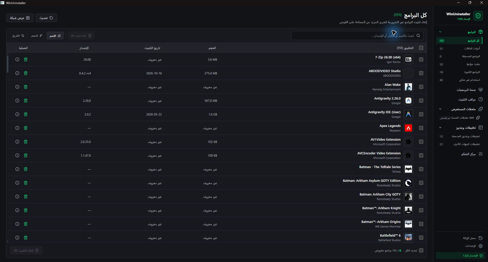
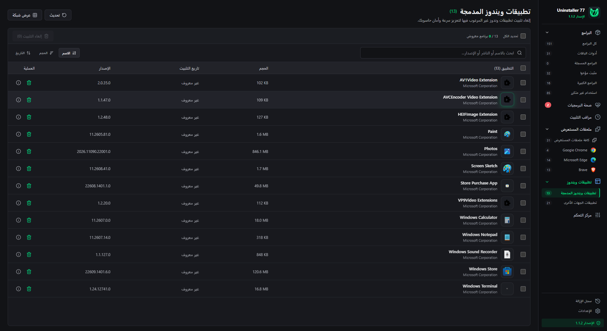
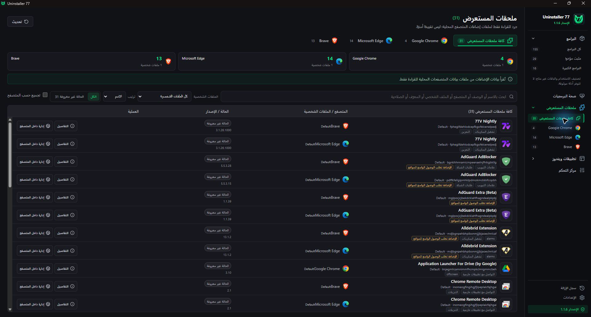
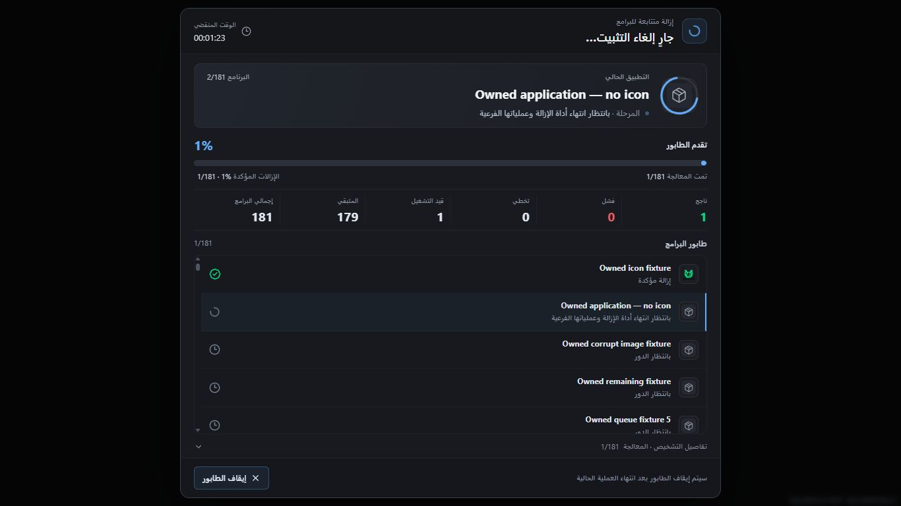
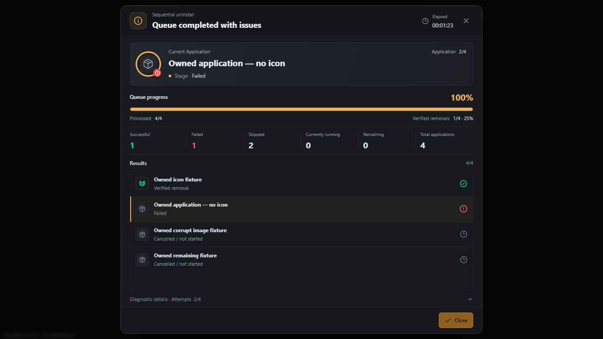
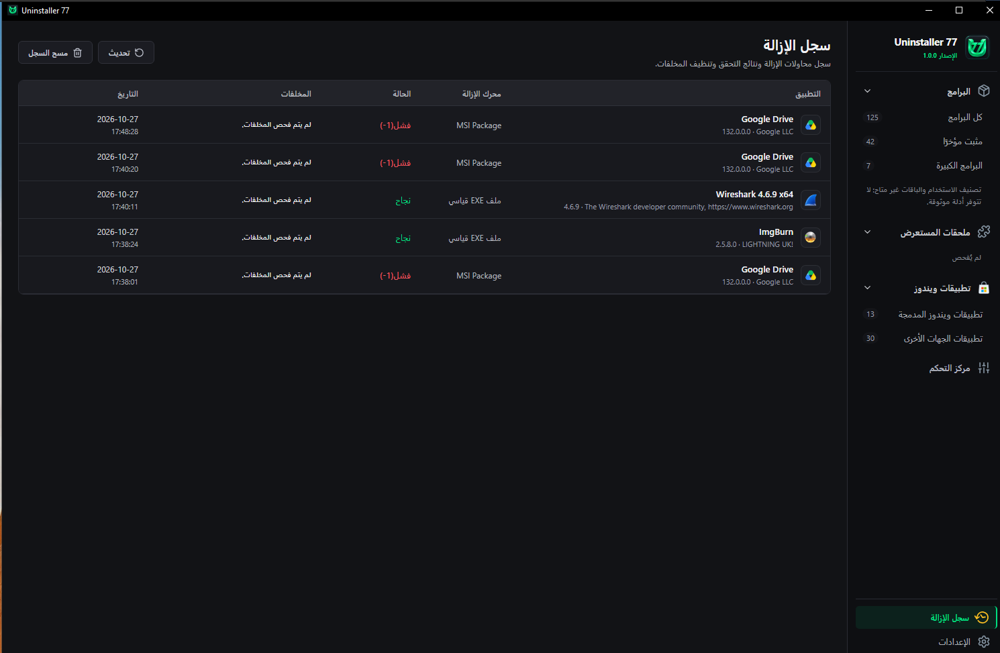

<p align="center"></p>
<h1 align="center">Uninstaller 77</h1>
<p align="center">إدارة برامج ويندوز، مع سجل واضح لكل محاولة إزالة.</p>
<p align="center"><b>1.0.1 · Windows 10 / 11 x64 · العربية والإنجليزية · MIT</b></p>
<p align="center"><a href="https://github.com/abooodHub/Uninstaller77/releases/download/v1.0.1/Uninstaller77-Setup.exe">تحميل المثبت</a> · <a href="https://abooodhub.github.io/Uninstaller77/">صفحة البرنامج</a> · <a href="README.md">English</a></p>

## الخصائص

- **جرد البرامج:** بحث وفرز لبرامج Registry وحزم MSIX/AppX للمستخدم الحالي، مع معلومات الناشر والإصدار والحجم وأمر الإزالة عند توفرها.
- **إزالة متتابعة:** معالجة البرامج التي اخترتها واحدًا تلو الآخر، مع المرحلة الحالية والوقت وعدادات منفصلة للنجاح والفشل والتخطي.
- **نتيجة خاصة بكل برنامج:** حفظ رمز الخروج المرصود وتشخيص الفشل مع العنصر الصحيح، حتى بعد اكتمال العنصر التالي.
- **مراجعة المخلفات:** فحص المواقع المدعومة بعد الإزالة المؤكدة، وعزل المجلدات المؤهلة بعد مراجعتها، وإمكان استعادتها بملفات بيانات الاستعادة.
- **جرد إضافات المتصفح:** عرض إضافات Chrome وEdge وBrave بحسب المتصفح والملف الشخصي، مع صلاحيات البيان وسياسات الإدارة المكتشفة. هذه الخاصية للقراءة فقط.
- **تجربة سطح مكتب:** دعم RTL للعربية وLTR للإنجليزية، وتصدير CSV، وسجل محلي، وإجراء في قائمة Explorer لاختصارات التطبيقات.

[▶ مشاهدة فيديو البرنامج](https://youtu.be/bUDDOJ_9fTo)

## صور البرنامج

[افتح معرض الصور التفاعلي: 8 صور مع التكبير والتصنيف](https://abooodhub.github.io/Uninstaller77/#gallery)

<table>
<tr>
<td width="50%"><a href="docs/site/assets/programs-ar.jpg"></a><br>قائمة البرامج · لقطة تطوير</td>
<td width="50%"><a href="docs/site/assets/windows-apps.png"></a><br>حزم Windows · لقطة تطوير</td>
</tr>
<tr>
<td width="50%"><a href="docs/site/assets/extensions.png"></a><br>الإضافات · لقطة تطوير</td>
<td width="50%"><a href="docs/site/assets/queue.png"></a><br>الطابور · بيانات اختبار</td>
</tr>
<tr>
<td width="50%"><a href="docs/site/assets/results.png"></a><br>النتائج · بيانات اختبار</td>
<td width="50%"><a href="docs/site/assets/history.png"></a><br>السجل · جلسة المستخدم</td>
</tr>
</table>

*صور أصلية من التطوير والاختبار. بعض اللقطات تعرض قوائم أو أزرارًا قديمة أزيلت لاحقًا؛ جرد إضافات المتصفح الحالي للقراءة فقط. صور الطابور والنتائج معاينات ببيانات اختبار مملوكة للمشروع. يوضح المعرض سياق كل صورة.*

## التثبيت

1. ثبّت **.NET 8 Desktop Runtime (x64)** و**Microsoft Edge WebView2 Runtime** إن لم يكونا موجودين.
2. حمّل [ملف التثبيت](https://github.com/abooodHub/Uninstaller77/releases/download/v1.0.1/Uninstaller77-Setup.exe) من صفحة الإصدار.
3. أغلق أي نسخة مفتوحة قبل التحديث، ثم شغّل Setup. المثبت إنجليزي، ولغة التطبيق تُختار من الإعدادات.

يتحقق المثبت من المتطلبات قبل تثبيت ملفات التطبيق؛ المتطلبات غير مرفقة معه. قد تحتاج أدوات الإزالة التابعة للبرامج إلى مطالبة UAC أو نافذة تأكيد خاصة بها.

يمكن مقارنة بصمة الملف مع [SHA256SUMS.txt](https://github.com/abooodHub/Uninstaller77/releases/download/v1.0.1/SHA256SUMS.txt):

```powershell
Get-FileHash .\Uninstaller77-Setup.exe -Algorithm SHA256
```

## فهم النتائج

يشغّل البرنامج مزيل التثبيت المسجّل، ثم يفحص دليل الإزالة. تعني نسبة **100%** انتهاء معالجة الطابور، وليس نجاح إزالة جميع البرامج. يمنع طلب الإيقاف بدء العنصر التالي بعد انتهاء العملية الحالية، ولا ينهي مزيل الشركة بالقوة.

يحافظ محرك 1.0.1 على أوامر EXE حتى عندما يكون اسم مفتاح Registry على شكل GUID، بما فيه نمط تسجيل Google Drive المرصود. قد يرفض مزيل شركة أخرى العملية أو يحتاج إلى تدخلك؛ لا يوجد ضمان بإزالة كل حزمة ويندوز محمية أو تنظيف كل موقع.

## البناء والاختبارات

التفاصيل في [دليل البناء](docs/BUILDING.md) و[نطاق الاختبارات](docs/TESTING.md).

```powershell
.\Build.ps1

dotnet run --project .\tests\Engine.Tests\Engine.Tests.csproj -c Release -- --report-dir .\_build\engine-tests
```

التطبيق مبني بـWPF وWebView2 وواجهة React/CSS مرفقة محليًا. صفحة التعريف الثابتة في `docs/site/`. لا تُرفع قواعد البيانات أو السجلات المحلية أو مخرجات البناء أو الأدلة الهندسية الخاصة إلى Git.

## الترخيص

المصدر بترخيص [MIT](LICENSE). تبقى المكونات الخارجية وشعارات المتصفحات تحت شروط أصحابها؛ راجع [الإشعارات](THIRD_PARTY_NOTICES.md). احذف البيانات الشخصية من السجلات والصور قبل فتح بلاغ عام.
