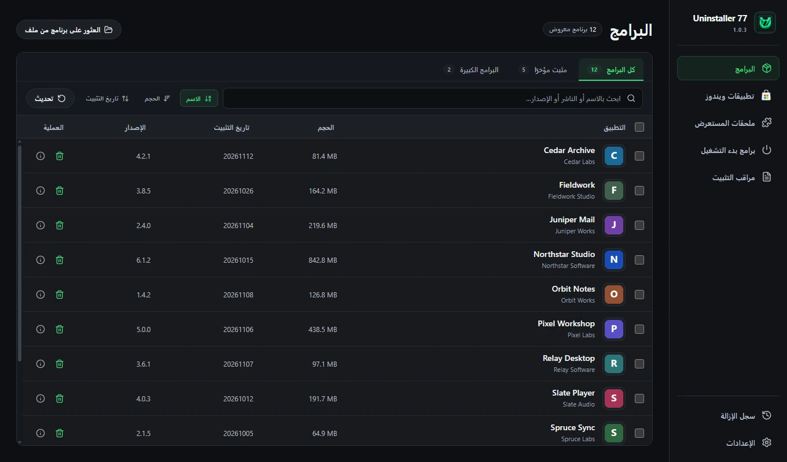
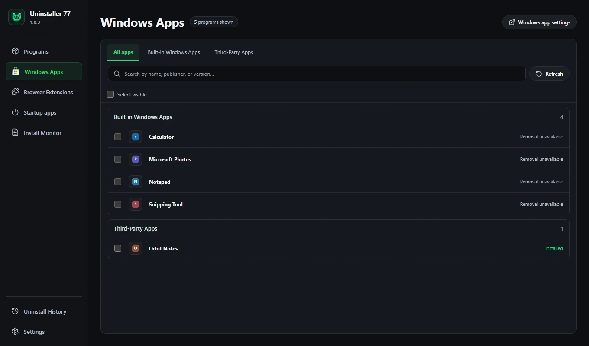
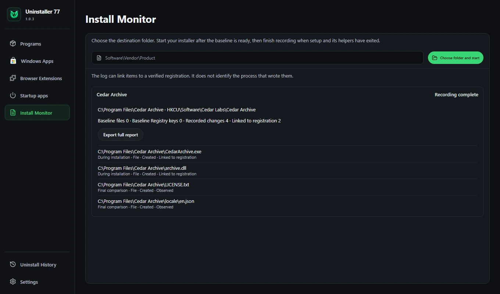
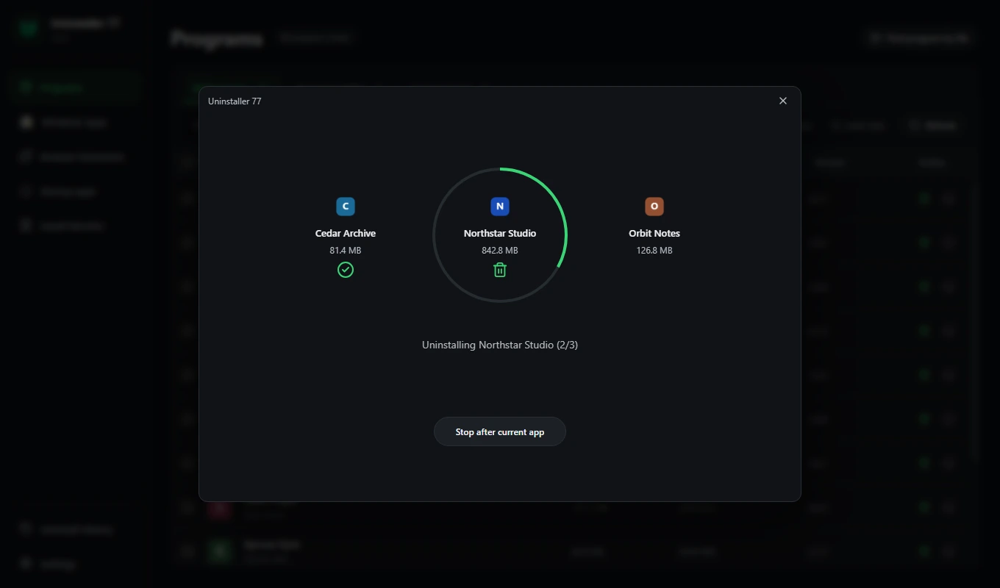
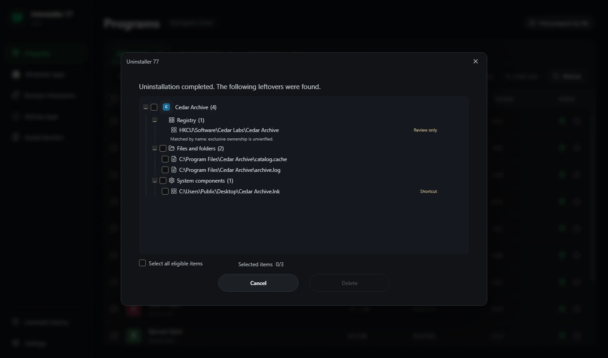
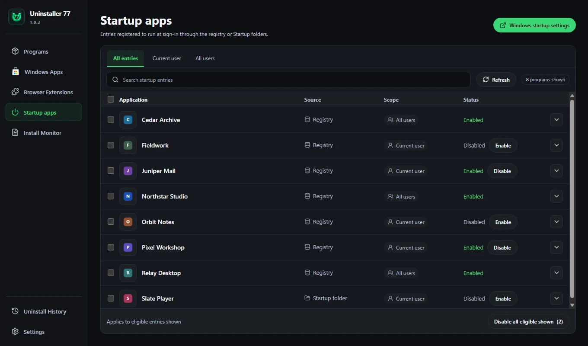

<p align="center"></p>
<h1 align="center">Uninstaller 77</h1>
<p align="center">Windows application management, with a clear record of every uninstall attempt.</p>
<p align="center"><b>Release 1 (1.0.3 preview) · Windows 10 / 11 x64 · Arabic &amp; English · MIT</b></p>
<p align="center"><a href="https://github.com/abooodHub/Uninstaller77/releases/download/v1.0.3/Uninstaller77-Setup.exe">Download installer</a> · <a href="https://abooodhub.github.io/Uninstaller77/">Product website</a> · <a href="README.ar.md">العربية</a></p>

## Features

- **Application inventory:** search and sort Registry programs and current-user MSIX/AppX packages, with available publisher, version, size and uninstall-command information.
- **Sequential queues:** process the applications you selected one at a time, with elapsed time, current stage and separate successful, failed and skipped counts.
- **Per-app results:** retain observed exit codes and failure diagnostics on the correct application, including after a later item completes.
- **Reviewed cleanup:** inspect leftovers after verified removal. Eligible selected items can be cleaned, with recoverable backups for supported Registry entries.
- **Browser extensions:** inspect extensions by browser and profile, and open supported browsers’ own management pages to make changes.
- **Startup and installation monitoring:** review supported startup entries and enable or disable eligible ones. Record installation changes in a chosen folder and optional Registry key, then export the report.
- **Desktop workflow:** Arabic RTL / English LTR, CSV export, local history, and an Explorer context-menu action for application shortcuts.

[▶ Watch the product video](https://youtu.be/bUDDOJ_9fTo)

## Screenshots

[Explore the full-size screenshot gallery](https://abooodhub.github.io/Uninstaller77/#gallery)

<table>
<tr>
<td width="50%"><a href="docs/site/assets/release-1-programs-ar.webp"></a><br>Programs in Arabic</td>
<td width="50%"><a href="docs/site/assets/release-1-windows-apps.webp"></a><br>Windows apps</td>
</tr>
<tr>
<td width="50%"><a href="docs/site/assets/release-1-monitor.webp"></a><br>Install Monitor</td>
<td width="50%"><a href="docs/site/assets/release-1-queue.webp"></a><br>Uninstall queue</td>
</tr>
<tr>
<td width="50%"><a href="docs/site/assets/release-1-leftovers.webp"></a><br>Leftover review</td>
<td width="50%"><a href="docs/site/assets/release-1-startup.webp"></a><br>Startup apps</td>
</tr>
</table>

*Screenshots from Release 1 (1.0.3) with demonstration data.*

## Install Release 1

1. Download [Uninstaller77-Setup.exe](https://github.com/abooodHub/Uninstaller77/releases/download/v1.0.3/Uninstaller77-Setup.exe) from the release.
2. Close any running copy before upgrading, then run Setup. The installer is in English. Choose Arabic or English in the app.

Setup bundles the .NET 10 Desktop Runtime and the WebView2 Evergreen installer. This build is unsigned. Full VMware acceptance of the new installer and the install-monitor-to-leftovers workflow is pending.

Check the installer against the [published SHA-256 sums](https://github.com/abooodHub/Uninstaller77/releases/download/v1.0.3/SHA256SUMS.txt).

```powershell
Get-FileHash .\Uninstaller77-Setup.exe -Algorithm SHA256
```

## How uninstall results work

The app launches the registered vendor uninstaller and checks removal evidence. A queue reaching **100%** means its items have been processed; it does not mean every application was removed. A stop request prevents the next item from starting after the current operation; it does not force-kill the vendor uninstaller.

The engine preserves registered EXE uninstall commands even under GUID-shaped keys. Third-party uninstallers may reject an operation or require user input. Windows protection can prevent removal of some packages.

## Build and verify

See [BUILDING.md](docs/BUILDING.md) for build instructions and [TESTING.md](docs/TESTING.md) for validation scope.

```powershell
.\Build.ps1

dotnet run --project .\tests\Engine.Tests\Engine.Tests.csproj -c Release -- --report-dir .\_build\engine-tests
```

The application uses WPF, WebView2 and a bundled React/CSS interface. The static product page is in `docs/site/`. Local logs, databases, installers, dependency caches and historical evidence are excluded from Git.

## License and contributions

[MIT](LICENSE). Third-party components and browser marks retain their own terms; see [THIRD_PARTY_NOTICES.md](THIRD_PARTY_NOTICES.md). Contributions should follow [CONTRIBUTING.md](CONTRIBUTING.md). Please redact personal paths and logs before opening an issue.
